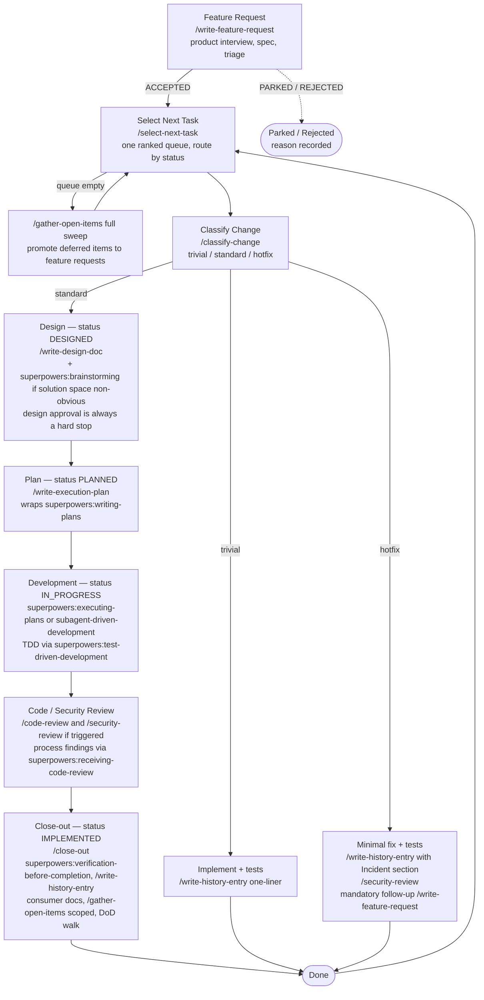

# SDLC Process Contract

Drop this file into a project (as `CLAUDE.md`, or referenced from it) to make Claude Code work through every change the same way. It is **stack-neutral** — pair it with a stack conventions doc (`CLAUDE.stack.md`; see `CLAUDE.stack.example.md` in the kit for a worked example).

Run `/setup-sdlc` once per project before using this process — it maps the repo, adapts the stack doc, builds the repository catalog, records the autonomy policy below, and optionally bootstraps `docs/design/`.

---

## Lifecycle

```
Feature Request → Design → Plan → Development → Code/Security Review → Close-out
```



Every change also has a **tier**, decided by `/classify-change` before any code is written:

| Tier | Trigger | Pipeline |
|---|---|---|
| **trivial** | No behavior/schema/API/auth/dependency change; ≤2 files, ~20 lines | History one-liner + tests if behavior-adjacent. Nothing else. |
| **standard** | Any feature or behavior change | Full lifecycle. |
| **hotfix** | A shipped change is causing a live problem | Immediate minimal fix/revert + tests + history entry with an Incident section + a **mandatory** follow-up feature request. |

`/classify-change` is authoritative. Auth, data-access, API-surface, schema/migration, API-key, and dependency changes are **never trivial** regardless of size. When uncertain, the tier is `standard`. A trivial change that grows mid-implementation is stopped and re-classified. For a multi-repo effort, `/classify-change` runs per repo — the effort tier is the highest across its repos.

---

## Working in the meta-root

Your project has a **meta-root** (recommended: its own git repo, so the docs trail is versioned): this process contract, the skills, `repos.yml` (the repository catalog), and the `docs/` trail. Code repos are checked out under `workspace/<key>/` (git-ignored), assembled per effort by `scripts/assemble-env.mjs`.

- Open your editor on `workspace/<key>/` for hands-on code work.
- The agent `cd`s into `workspace/<key>/` for every stack command — build, test, `git`, `gh`. Never run bare `git`/test/build at the meta-root.
- A repo marked `readonly: true` in `repos.yml` is **reference**: read it, never change it. `assemble-env.mjs` checks it out detached at the default branch, with commits and pushes blocked. A change it would need goes in the design doc's Open Items as a request to its owners.
- File references in artifacts use `<key>:<repo-relative-path>`; a bare path means the meta-root.
- A solo project is **N=1**: one `repos.yml` entry, one repo under `workspace/`. Same machinery, no per-repo ceremony worth the name.

---

## Workers and the board

**Board mode** is on when `board/` exists in the meta-root (the installer creates it with `--board`, or the first `sdlc worker create` does). Without `board/`, skip everything in this section: the process runs as a single interactive session.

With board mode on, the meta repo's `main` branch is the **board**: the one place every worker and every interactive session coordinates. `scripts/sdlc.mjs` is the client; the skills call it, and so do people.

- **Claim before working.** A claim is the feat-req's `claimed_by` / `claimed_at` / `renewed_at`, committed to `main`. It counts only once it is on `origin/main`. Claim with `node scripts/sdlc.mjs claim <slug>`; an interactive session claims as the person's GitHub login.
- **Leases.** Every report renews the claim. A claim with no renewal for `lease_ttl` (default 4h, set in `board/config.yml`) is stale, and anyone may take it over. One rule for everyone: workers and interactive sessions alike.
- **Report each phase.** When a skill changes an effort's `status`, it ends with `node scripts/sdlc.mjs report <slug> --phase <status>`. Exit `3` means someone else now holds the effort: tell the person and stop working on it.
- **Release at the end.** `/close-out` runs `node scripts/sdlc.mjs release <slug>` after `IMPLEMENTED`.
- **Requests to people.** A worker never waits on a person. It posts a request file under `board/requests/` (gate, question, clarification or error). A blocking request sets `awaiting` on the feat-req and releases the claim in the same commit. People see their requests with `sdlc inbox` and answer with `sdlc answer <id>`.
- **Answers change nothing by themselves.** Answering writes only the request file. The next claimant applies the answer, records it under the feat-req's `## Decisions` citing the request id, and deletes the request. No client changes lifecycle state when answering.
- **Workers** are run with `sdlc worker create | start | stop | status | list | retire`. Each has its own home (`~/.sdlc/workers/<id>/`) and its own clone of the meta repo.

The full protocol is in `docs/design/workers.md` (the kit's design doc).

---

## Autonomy Policy

`/setup-sdlc` writes this block. Skills read it to decide whether a gate is a hard stop or an auto-proceed. Hand-edit it any time.

```yaml
autonomy:
  task_selection: confirm        # confirm | auto
  product_brainstorm: discuss    # discuss | solo
  technical_brainstorm: solo     # discuss | solo
  implementation_checkpoints: pause  # pause | run-through
```

**Always a hard stop, regardless of policy:** design-doc approval, feature-request triage (accept/park/reject), code/security review findings.

When a gate auto-proceeds, the agent records the decision and any assumptions in the relevant doc and stays interruptible.

### Headless mode

When `SDLC_HEADLESS=1` is set, the agent is a **worker's** run: nobody is at the terminal. Every place a skill would ask a person becomes a **request** in the result file instead:

- **Gate**: every always-hard-stop gate above, and every gate the policy sets to `confirm`, `discuss` or `pause`. `technical_brainstorm: discuss` becomes a gate carrying the 2–3 approaches as `Options`.
- **Question**: information only a person has, with lettered `Options` and your recommendation.
- **Clarification**: a judgment call with a safe default. Take the default, record the assumption in the effort's docs, and keep going (`blocking: false`).
- `task_selection` does not apply: the worker already chose the task.

Commit in code repos on `feat/<slug>` only. The meta repo is the worker's to commit: leave your doc edits uncommitted there and the worker reports them.

Before you stop, write `$SDLC_RESULT_FILE` as JSON, with one of three outcomes:

```json
{ "outcome": "completed", "phase": "DESIGNED", "summary": "one line", "development_done": false }
{ "outcome": "request", "request": { "kind": "gate|question|clarification|error", "gate": "design-approval", "for": "owner", "blocking": true, "sections": { "Request": "…", "Context": "…", "Options": "…" } } }
{ "outcome": "failed", "error": { "message": "…", "tried": "…" } }
```

- `phase` is the feat-req `status` the effort is in now (`ACCEPTED`, `DESIGNED`, `PLANNED`, `IN_PROGRESS` or `IMPLEMENTED`), matching what you wrote in the feat-req.
- `development_done: true` when the plan's last step is checked. The worker confirms it against the plan before routing to close-out.
- `for: "owner"` addresses the worker's owner; `"approvers"` addresses whoever clears gates.
- Section values are plain text. The worker adds its own Context lines and formats the request file.

---

## Artifacts

| Phase | Artifact | Location | Produced by |
|---|---|---|---|
| Feature Request | Product spec | `docs/feat-req/<name>.md` | `/write-feature-request` |
| Design | Design doc | `docs/design/<name>.md` (matches feat-req name) | `/write-design-doc` |
| Plan | Execution plan | `docs/plans/<name>.md` | `/write-execution-plan` |
| Development | History entry | `docs/history/${timestamp}_<desc>.md` | `/write-history-entry` |
| Any decision with cross-feature or long-lived architectural consequence | ADR | `docs/decisions/${NNN}_<name>.md` | manual, format below |
| Close-out | Status flip + doc updates | — | `/close-out` |
| Setup (once) | Repository catalog | `repos.yml`, `repos/<key>.md` | `/setup-sdlc` |

`docs/design/architecture.md` and `docs/design/data-model.md` are living docs — updated in the same change whenever structure or schema moves. `docs/STATUS.md` is generated by `scripts/render-status.mjs` (never hand-edited). `repos.yml` is the repository catalog; `repos.example.yml` in the kit is the annotated template.

---

## State

Every feature request carries a `status` in its frontmatter. This is the **single source of truth** — no filename prefixes. `select-next-task` and `render-status.mjs` rank on it.

| `status` | Set by | Meaning |
|---|---|---|
| `ACCEPTED` | `/write-feature-request` triage | Spec approved, in the queue |
| `PARKED` | `/write-feature-request` triage / open-items sweep | Valid, not now — reason recorded, invisible to `select-next-task` |
| `REJECTED` | `/write-feature-request` triage | Not doing it — reason recorded, kept for the record |
| `DESIGNED` | `/write-design-doc` (on approval) | Design doc `APPROVED`, ready to plan |
| `PLANNED` | `/write-execution-plan` | Plan exists and is stamped |
| `IN_PROGRESS` | Development phase entry | Being built |
| `IMPLEMENTED` | `/close-out` | Definition of Done satisfied |

In board mode (see **Workers and the board**) the feat-req also carries:

| Field | Meaning |
|---|---|
| `claimed_by` | Who works on the effort now: a worker id, or a person's GitHub login |
| `claimed_at` | When that claim started |
| `renewed_at` | The claim's last renewal; stale after `lease_ttl` |
| `awaiting` | The id of an open blocking request; the effort waits until it is answered |

Only `sdlc` writes these fields. Applied answers are logged under the feat-req's `## Decisions`, each line citing its request id.

Design docs carry their own `status: DRAFT | APPROVED`. Plans carry `status: PLANNED | IN_PROGRESS | IMPLEMENTED` plus `feat_req:` and `design:` links. Design docs and plans also carry `repos:` (the effort's repo set, locked at design approval); `select-next-task` runs `assemble-env.mjs` from it before routing a `DESIGNED`-or-later effort.

---

## Definition of Done

A **standard**-tier task is complete only when every item holds. `/close-out` walks this list explicitly in its output.

- [ ] Design doc in `docs/design/` describing the change
- [ ] Execution plan in `docs/plans/`, all steps checked
- [ ] `architecture.md` / `data-model.md` updated if structure or schema changed
- [ ] README (and any consumer-facing docs / API descriptions) updated, or "no consumer-facing impact" recorded
- [ ] Tests written/updated for new/changed behavior (TDD during Development)
- [ ] All existing tests pass — verified via `superpowers:verification-before-completion` with recorded evidence
- [ ] `/code-review` run, findings addressed or rationale recorded
- [ ] If any Security Review trigger applied (auth, new external endpoint, data-access control, API-key logic): `/security-review` run and findings documented. Otherwise the design doc states "no security-relevant changes."
- [ ] History entry in `docs/history/` (Deviations / Discoveries / Decisions / Step status / Verification; `## Per-Repo Summary` for multi-repo)
- [ ] A merged PR in every repo in the plan's `## Repositories`; links in `## Pull Requests`; merge order per the design doc's `### Merge order` — verified live via `gh` (multi-repo efforts)
- [ ] Design doc `## Open Items` section populated; scoped open-items reconciliation run
- [ ] `status: IMPLEMENTED` on the feature request

**trivial**: history one-liner (tier + justification + files touched) + passing tests. **hotfix**: fix + tests + history entry with Incident section + follow-up feature request filed.

---

## Open Items

After every standard feature, the design doc ends with:

```
## Open Items
- [ ] ...
```

`None` only if genuinely zero. `/close-out` runs a scoped reconciliation over these: an item is **promoted to a feature request now** if it is (i) a known correctness or security gap, (ii) blocks a stated near-term feature, or (iii) small and well-understood enough that filing costs less than re-deriving later. Otherwise it stays deferred with a one-line rationale. `/gather-open-items` re-evaluates deferred items in its full-sweep mode (run on demand, or automatically when `select-next-task` finds an empty queue).

---

## Style Guide

If the project has `docs/design/STYLE_GUIDE.md`, every UI or user-facing-output change must conform to it, and `/code-review` verifies UI diffs against it. The design doc records UI/UX changes and cites the relevant style-guide sections. Update the style guide (with the user's agreement) when a change establishes a new pattern. See `STYLE_GUIDE.template.md` in the kit.

---

## Architecture Decision Records

Create an ADR in `docs/decisions/` (`${NNN}_decision-name.md`) when a decision has **cross-feature or long-lived architectural consequence** — something a developer working on an unrelated part of the system would need to know:

- Choosing between two or more meaningful technical approaches with lasting effect
- Deviating from an existing pattern in the codebase
- Adding or removing a dependency

Feature-local tradeoffs ("which of these three ways to build X") belong in the design doc's **Alternatives Considered** section, not a separate ADR. When a design doc's alternative rises to ADR level, write the ADR and link it from that section.

```markdown
# [Decision title]

## Status
Accepted | Superseded by [link]

## Context
What problem or question forced this decision?

## Options Considered
- **Option A** — description, pros/cons
- **Option B** — description, pros/cons

## Decision
What was chosen and why.

## Consequences
Trade-offs accepted. Known limitations. Follow-up decisions this creates.
```

---

## Layer & module rules

Stack-specific — see `CLAUDE.stack.md`.
