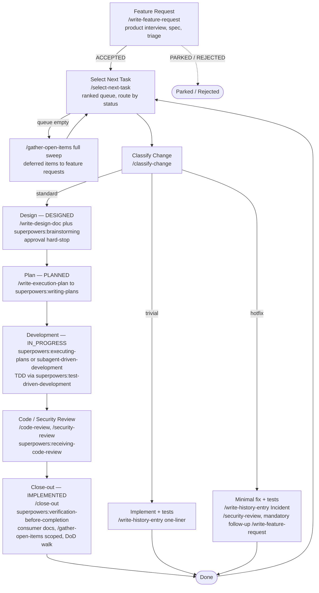

# sdlskills

A reusable **agentic SDLC kit** for Claude Code and GitHub Copilot: an opinionated, artifact-driven development process plus the skills that implement each phase.

**Just want to install it?** Check the [prerequisites](#prerequisites), then go to [Install](#install).

## Contents

- [Getting started](#getting-started)
  - [Prerequisites](#prerequisites)
  - [What is a meta-root?](#what-is-a-meta-root)
  - [Install](#install)
  - [What you'll see](#what-youll-see)
  - [After install](#after-install)
  - [Troubleshooting](#troubleshooting)
- [The idea](#the-idea)
- [Layout](#layout)
- [Skills](#skills)
- [Non-goals](#non-goals)
- [License](#license)

## Getting started

Install the kit into a separate SDLC repo (the *meta-root*), not into your code repository. Check the prerequisites, then run one command.

### Prerequisites

| You need | Required? | Why |
|---|---|---|
| Node 20 or newer | yes | the installer and the kit's scripts run on Node |
| git | yes | your SDLC repo is a git repo; the process works in branches and PRs |
| Claude Code **or** GitHub Copilot (VS Code or CLI) | one of them | where you run the skills |
| Claude Code CLI / Copilot CLI | optional | only so the installer can install the `superpowers` plugin for you. VS Code users can install the plugin from the IDE instead |
| GitHub CLI (`gh`) | optional for now | used at close-out to verify merged PRs |

The installer checks all of this and tells you what is missing and how to get it.

### What is a meta-root?

The kit does **not** go into your code repository. It goes into a separate folder, your **SDLC repo** (the *meta-root*), that holds the process, the skills and the `docs/` trail. Your code repositories stay untouched; the kit checks out just the ones an effort needs, under `workspace/`.

```
acme-api/                    your code repository: untouched
acme-web/                    another code repository: untouched

acme-workspace/              your SDLC repo (the meta-root): install the kit HERE
├── docs/                    feature requests, designs, plans, history
├── .claude/skills/          the kit's skills (.github/skills/ for Copilot)
├── repos.yml                which repos you have and what each does
└── workspace/               temporary checkouts of the repos an effort needs
    ├── acme-api/
    └── acme-web/
```

A solo project has the same shape with one repo. Note that `workspace/` inside the SDLC repo is a different thing from the SDLC repo's own folder name.

### Install

From a terminal in the `sdlskills` folder, run:

```bash
cd /path/to/sdlskills
node install-sdlc.mjs
```

It asks which tool you use (Claude Code or GitHub Copilot, VS Code or CLI), then starts a **guided install**: it explains the meta-root, checks the prerequisites, asks where to install (type a folder path; it is created if needed), warns if the folder looks like a code repository, shows what it will do, and asks before it does anything.

You can also run it from any other folder using the full path to the script. In that case it suggests a new `<current-folder>-workspace` folder next to where you are.

For scripts and CI, skip the question and run an installer directly with the folder: `node scripts/install-sdlc.mjs <target-dir>` (Claude Code) or `node scripts/install-sdlc-copilot.mjs <target-dir>` (Copilot). These never prompt. Other flags: `--dry-run` shows the plan and changes nothing, `--skip-plugins` and `--skip-npm` opt out of those steps. Re-run it to update the vendored skills and scripts in place; your `CLAUDE.stack.md`, `package.json` and `.gitignore` edits are left alone.

The Copilot cloud agent isn't supported, because the process needs a person at its hard stops.

### What you'll see

An abbreviated guided run:

```
This installs the SDLC kit for Claude Code into your SDLC repo (the *meta-root*).
...
Prerequisites:
  ✓ Node 20 or newer (found 24.12.0)
  ✓ git
  - Claude Code CLI (`claude`) (optional): Not needed for the VS Code extension. ...
  ✓ GitHub CLI (`gh`)

Where should the SDLC repo go? [/home/you/projects/acme-workspace]
Here's what will happen:
  - create the folder /home/you/projects/acme-workspace
  - vendored 9 skills into .claude/skills/
  ...
Proceed? [Y/n]
```

It ends with three blocks: **Done** (what was written), **Needs attention** (anything missing or failed) and **Next steps**.

### After install

Follow the **Next steps** the installer prints. In short:

1. Install the `superpowers` plugin if the installer couldn't (it prints the exact command).
2. Claude Code only: reference `CLAUDE.process.md` and `CLAUDE.stack.md` from the SDLC repo's `CLAUDE.md`. Copilot loads them automatically.
3. Open the SDLC repo in Claude Code or Copilot and run `/setup-sdlc`. It builds `repos.yml` and runs the autonomy interview.
4. Start the loop: `/write-feature-request`, then `/select-next-task`.

### Troubleshooting

- **I installed into my code repository by mistake.** `git status` shows exactly what was added. Delete the untracked files and folders (the skills folder, the copied `scripts/`, `CLAUDE.process.md` or `.github/instructions/`, `repos.example.yml`, and the new `docs/` folders), then restore your own `package.json` and `.gitignore` with `git checkout -- package.json .gitignore`. Run the installer again against a new folder.
- **A prerequisite is missing.** The guided install lists each one with a link. Install it and run again.
- **Windows.** Run the installer with `node` from PowerShell, cmd or Git Bash. Use an up-to-date copy of the kit: earlier versions printed nothing and did nothing on Windows.

## The idea

The skills exist to serve a **process**, not the other way around. Drop the process contract into a project and Claude Code works through every change the same way:



Each phase produces a required artifact in a fixed location, so a project's history stays legible — you can tell *why* a change happened, not just *what* changed. Nothing is "done" until the Definition of Done is satisfied.

Three things keep it practical:

- **Three tiers.** `classify-change` sorts every change into *trivial* (history one-liner + tests), *standard* (full pipeline), or *hotfix* (fast lane + mandatory follow-up). The paper trail is proportional to the risk.
- **An autonomy policy.** `setup-sdlc` interviews you once about which gates should stop for your review and which should auto-proceed. Design approval, feature-request triage, and review findings are always hard stops; everything else is configurable.
- **Multi-repo by default.** Work happens in a *meta-root* holding the process and the `docs/` trail; a `repos.yml` catalog maps your repositories, and `assemble-env.mjs` checks out just the ones an effort needs under `workspace/`. Design resolves the repo set, `classify-change` runs per repo, and `close-out` verifies a merged PR in each. A solo project is N=1 — same machinery, one entry.

## Layout

| Path | Role |
|---|---|
| [`CLAUDE.process.md`](CLAUDE.process.md) | The stack-neutral process contract — lifecycle, tiers, state model, Definition of Done, ADR format, autonomy policy. **This is the deliverable.** |
| [`CLAUDE.stack.example.md`](CLAUDE.stack.example.md) | Worked example of the stack-conventions half (NestJS/Prisma/React). Adopters replace it. |
| [`skills/`](skills/) | The nine phase skills. |
| [`install-sdlc.mjs`](install-sdlc.mjs) | **Start here.** Asks which tool you use, then runs the matching installer — see [Getting started](#getting-started). |
| [`scripts/install-sdlc.mjs`](scripts/install-sdlc.mjs) | The Claude Code installer: scaffolds the kit into a target project. `scripts/install-sdlc-copilot.mjs` is the Copilot one. |
| [`scripts/render-status.mjs`](scripts/render-status.mjs) | Derives `docs/STATUS.md` from feature-request frontmatter. Wired to a `Stop` hook. |
| [`scripts/assemble-env.mjs`](scripts/assemble-env.mjs) / [`clean-env.mjs`](scripts/clean-env.mjs) | Reconstruct / tear down `workspace/` for a multi-repo effort (see the execution-environment feature). |
| [`repos.yml`](repos.yml) / [`repos/`](repos/) | The repository catalog — which repo does what. `repos.example.yml` is the annotated template. |
| [`examples/react-components/`](examples/react-components/) | Optional React admin-console conventions skill. |
| [`docs/design/STYLE_GUIDE.template.md`](docs/design/STYLE_GUIDE.template.md) | Starting point for a project style guide. |
| [`docs/kit-open-items.md`](docs/kit-open-items.md) | Unresolved design questions about the kit itself. |

## Skills

| Skill | Phase |
|---|---|
| `setup-sdlc` | One-time adoption: map repo, adapt stack doc, build the repository catalog, autonomy interview, optional `docs/design/` bootstrap |
| `write-feature-request` | Feature Request — product interview → spec → triage (accept/park/reject) |
| `classify-change` | Tier decision (trivial / standard / hotfix) before any code |
| `write-design-doc` | Design — fixed-structure design doc, conditional technical brainstorm, hard-stop approval |
| `write-execution-plan` | Plan — wraps `superpowers:writing-plans`, enforces location + frontmatter + state |
| `write-history-entry` | Development — intent-vs-reality execution trace |
| `select-next-task` | Picks the next task from one unified ranked queue, routes it to the right phase |
| `gather-open-items` | Reconciles Open Items — scoped (at close-out) and full-sweep (empty queue / on demand) |
| `close-out` | Definition-of-Done walk, consumer-doc updates, Open Items reconciliation, status flip |

External: `superpowers` plugin (`writing-plans`, `brainstorming`, `executing-plans`, `subagent-driven-development`, `receiving-code-review`, `verification-before-completion`), plus built-in `/code-review` and `/security-review`.

## Non-goals

No application code. Process + tooling only, layered onto whatever codebase adopts it. Multi-agent / parallel execution is out of scope for now — see [`docs/kit-open-items.md`](docs/kit-open-items.md).

## License

[MIT](LICENSE) © Lidor Linder. The software is provided as is, without warranty or liability; see the license text.
