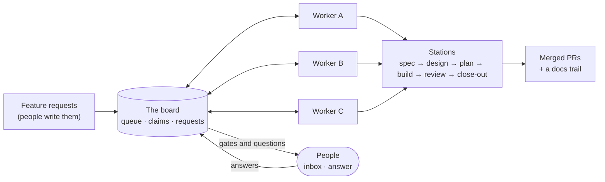
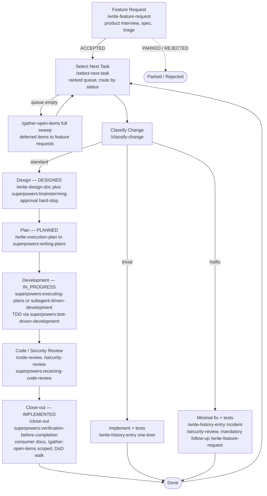

# sdlskills

**A software factory for AI coding agents.** Write feature requests; get reviewed, merged pull requests back, with a readable record of every decision. Claude Code or GitHub Copilot does the work. You decide at the gates.

It runs on three layers, all in this repo:

- **The factory floor.** A work board in git and persistent **workers** that take efforts off it, run them headless, and post a request whenever a person has to decide. Add workers on any machine to move more work at once.
- **The process.** One development lifecycle every change follows, from spec to close-out, with tiers that scale the paperwork to the risk and a Definition of Done that decides when a change is finished. The process is what makes agent output reviewable.
- **The tooling.** Nine skills that carry out each phase, the `sdlc` CLI that runs the board and the workers, and an installer for Claude Code or Copilot.

Start with one interactive session, where you drive each phase yourself. Turn on the board and add workers when you want the factory to run without you at every step.

**Just want to install it?** Check the [prerequisites](#prerequisites), then go to [Install](#install).

## Contents

- [How the factory works](#how-the-factory-works)
- [The process inside](#the-process-inside)
- [Concepts](#concepts)
- [Run it](#run-it)
  - [Prerequisites](#prerequisites) · [Install](#install) · [After install](#after-install)
  - [Stage 1: one session](#stage-1-one-session)
  - [Stage 2: add workers](#stage-2-add-workers)
  - [Troubleshooting](#troubleshooting)
- [Reference](#reference): [the lifecycle](#the-lifecycle) · [skills](#skills) · [layout](#layout) · [non-goals](#non-goals)
- [License](#license)

## How the factory works

Specs come in, merged pull requests come out. Agents do the work at each station, and people step in only at the decision gates.



| Factory part | What it is here |
|---|---|
| **Intake** | Feature requests. `/write-feature-request` interviews you, writes the spec and asks you to accept, park or reject it. Accepted requests join the queue. |
| **Conveyor** | The **work board**: your SDLC repo's `main` branch. Efforts are queued, claimed and tracked there as small commits. Nothing else coordinates the work, and there's no server. |
| **Operators** | **Workers**: persistent agent processes you own, on any number of machines. Each one takes the next effort, runs one station headless with Claude Code or Copilot, reports, and moves on. |
| **Stations** | The lifecycle phases. Each has a skill and leaves an artifact in a fixed place: spec, design doc, plan, history entry, close-out. |
| **Gates** | The decisions only a person makes: triage, design approval, review findings, and any step your autonomy policy holds back. A worker never waits at a gate. It posts a **request** to the board and takes other work. |
| **Inspection** | Reviews at each step, plus the Definition of Done. Nothing is closed until every item holds. |
| **Shift log** | The `docs/` trail and `docs/STATUS.md`: what was decided, why, and where every effort stands. |

**Still being built.** A complete factory also needs three things that are open feature requests today: an independent verification stage ([`independent-verification.md`](docs/feat-req/independent-verification.md)), a coordinator that serializes board writes ([`board-write-coordinator.md`](docs/feat-req/board-write-coordinator.md)), and breaking large features down into efforts ([`feature-breakdown.md`](docs/feat-req/feature-breakdown.md)).

## The process inside

Every station follows one written process, [`CLAUDE.process.md`](CLAUDE.process.md). It's the factory's operating manual: workers and people read the same one.

- **Six phases**: feature request → design → plan → development → review → close-out. Each phase is a skill and leaves a document, so you can always tell *why* a change happened, not just *what* changed. The full diagram is in [the lifecycle](#the-lifecycle).
- **Three tiers**: before any code, every change is classified as *trivial* (tests plus a one-line history entry), *standard* (the full pipeline) or *hotfix* (a fast lane with a mandatory follow-up).
- **Gates you set once**: at setup you choose which steps stop for you. Triage, design approval and review findings always do.
- **Multi-repo by default**: one SDLC repo holds the process and the trail. Your code repos stay untouched and are checked out only while an effort needs them.
- **A Definition of Done**: design, plan, tests, reviews, docs, history and merged PRs, walked item by item before anything is marked finished.

## Concepts

- **Meta-root (your SDLC repo).** The factory lives in its own repo, next to your code, never inside it. That repo holds the process, the skills, the `docs/` trail and a catalog of your code repos (`repos.yml`). Code repos are checked out under `workspace/` only while an effort needs them.
- **Effort.** One feature moving through the lifecycle. It starts as a feature request in `docs/feat-req/<name>.md`.
- **Phases and artifacts.** Feature request → design → plan → development → review → close-out. Each phase is a skill, and each leaves a document in a fixed location, so you can always tell *why* a change happened, not just *what* changed.
- **State.** An effort's position is one field, `status`, in its feature request: `ACCEPTED`, `DESIGNED`, `PLANNED`, `IN_PROGRESS`, `IMPLEMENTED` (or `PARKED` / `REJECTED`).
- **Tiers.** Before any code, every change is classified: *trivial* (tests plus a one-line history entry), *standard* (the full pipeline) or *hotfix* (a fast lane with a mandatory follow-up). The paperwork scales with the risk.
- **Autonomy policy and gates.** At setup the kit asks which steps should stop for you and which can proceed on their own. Triage, design approval and review findings always stop.
- **Definition of Done.** The checklist `close-out` walks before an effort is marked `IMPLEMENTED`: design, plan, tests, reviews, docs, history, merged PRs.
- **Board.** With board mode on, your SDLC repo's `main` branch is the shared queue. Workers and people coordinate there.
- **Claim and lease.** Before working on an effort, a worker or a person **claims** it, which is a small commit on `main`. Every report renews the claim. A claim left unrenewed for the lease time (4h by default) is stale, and anyone may take the effort over.
- **Worker.** A persistent process owned by one person. It has its own home and its own clone of the SDLC repo, so many can run side by side. It loops: claim, run one phase headless, report, repeat.
- **Request.** What a worker posts when it needs a person: a **gate** (an approval), a **question**, a **clarification** (an assumption to confirm) or an **error**. Requests are files under `board/requests/`. People answer them with `sdlc answer`, and the next worker applies the answer and records the decision in the feature request.
- **Inbox.** Your open requests, oldest first: `sdlc inbox`.

## Run it

Install into a separate SDLC repo, run the process in one session until it fits your team, then add workers.

### Prerequisites

| You need | Required? | Why |
|---|---|---|
| Node 20 or newer | yes | the installer and the kit's scripts run on Node |
| git | yes | your SDLC repo is a git repo; the process works in branches and PRs |
| Claude Code **or** GitHub Copilot (VS Code or CLI) | one of them | where you run the skills |
| Claude Code CLI / Copilot CLI | optional | so the installer can install the `superpowers` plugin for you (VS Code users can install it from the IDE), and to run workers |
| GitHub CLI (`gh`) | optional for a solo session | verifies merged PRs at close-out; required for workers |

The installer checks all of this and tells you what is missing and how to get it.

The kit goes into a separate folder, your **SDLC repo** (the meta-root), never into a code repository:

```
acme-api/                    your code repository: untouched
acme-web/                    another code repository: untouched

acme-workspace/              your SDLC repo (the meta-root): install the kit HERE
├── docs/                    feature requests, designs, plans, history
├── .claude/skills/          the kit's skills (.github/skills/ for Copilot)
├── repos.yml                which repos you have and what each does
├── board/                   the work board (only if you turn it on)
└── workspace/               temporary checkouts of the repos an effort needs
    ├── acme-api/
    └── acme-web/
```

A solo project has the same shape with one repo.

### Install

From a terminal in the `sdlskills` folder, run:

```bash
cd /path/to/sdlskills
node install-sdlc.mjs
```

It asks which tool you use (Claude Code or GitHub Copilot, VS Code or CLI), then starts a **guided install**:
- it explains the meta-root and checks the prerequisites;
- it asks where to install (it creates the folder if needed) and warns if the folder looks like a code repository;
- it asks whether the project will run workers, which creates the board;
- it shows what it will do and asks before doing anything.

In a terminal you pick from menus with the arrow keys and Enter, and Tab completes folder names. With piped input it falls back to plain numbered questions. Set `NO_COLOR=1` to turn colors off. It ends with three blocks: **Done**, **Needs attention** and **Next steps**.

For scripts and CI, run an installer directly: `node scripts/install-sdlc.mjs <target-dir>` (Claude Code) or `node scripts/install-sdlc-copilot.mjs <target-dir>` (Copilot). These never prompt. The flags are:
- `--board` creates the work board;
- `--dry-run` shows the plan and changes nothing;
- `--skip-plugins` and `--skip-npm` opt out of those steps.

Re-run the installer to update the vendored skills and scripts in place. For Claude Code it also creates `CLAUDE.md` importing `CLAUDE.process.md` and `CLAUDE.stack.md`, or adds whichever import an existing `CLAUDE.md` lacks; Copilot loads its instruction files on its own. Re-runs leave your `CLAUDE.md`, `CLAUDE.stack.md`, `package.json`, `.gitignore` and board settings alone.

Re-running also replaces `CLAUDE.process.md`, so re-apply any tuned `breakdown:` values (under Autonomy Policy) afterwards.

The Copilot cloud agent isn't supported, because the process needs a person at its hard stops.

### After install

Follow the **Next steps** the installer prints. In short:

1. Install the `superpowers` plugin if the installer couldn't (it prints the exact command).
2. Open the SDLC repo in Claude Code or Copilot and run `/setup-sdlc`. It maps your repos into `repos.yml`, adapts the stack conventions and runs the autonomy interview.

### Stage 1: one session

You are the operator: you run each station in your session, and the agent follows the process.

1. **Capture an idea:** `/write-feature-request`. The agent interviews you, writes the spec to `docs/feat-req/`, and asks you to accept, park or reject it.
2. **Pick up work:** `/select-next-task`. It ranks everything in flight and every accepted request in one queue, and routes the top item to the right phase.
3. **Follow the route.** Depending on the effort's state, that's `/classify-change`, `/write-design-doc` (you approve the design), `/write-execution-plan`, development with the `superpowers` plan-execution skills, then reviews and `/close-out`.
4. **See where things stand:** `docs/STATUS.md`, regenerated after each session, or `npm run status`.

### Stage 2: add workers

Workers turn the process into a factory: more than one effort moves at once, on any number of machines, and you only answer what needs a person.

**Before you start:**

- Everyone who owns a worker can push to the SDLC repo's `main` directly. A `main` that requires pull requests blocks the protocol. Forbid force-pushes on it.
- Give push rights to `main` only to people you'd trust to run code on the worker machines. A worker runs the SDLC repo's own scripts and its agent loads the repo's `CLAUDE.md` and skills.
- `gh` is installed and logged in (`gh auth login`, then `gh auth setup-git`).
- The agent CLI (`claude` or `copilot`) is installed and logged in on each worker machine. The worker starts it as a child process, so a shell alias (e.g. `claude`) isn't on its PATH: put the real binary on PATH (e.g. `~/.local/bin`).
- Copilot runs shell commands without a sandbox, so give a Copilot worker its own OS user or VM.

**Turn the board on:** answer Yes to "Will this project run workers, or share one board across several people?" during the guided install, or pass `--board`. That creates `board/` and `board/config.yml` (lease length, poll intervals, timeouts). Commit and push them.

**Run a worker:**

```bash
node scripts/sdlc.mjs worker create --agent claude --model <model>   # once; registers the worker on the board
node scripts/sdlc.mjs worker start <id> --detach   # runs in the background; logs to ~/.sdlc/workers/<id>/logs/
node scripts/sdlc.mjs worker stop <id>             # releases its claim and stops cleanly
```

Run these from the SDLC repo's folder. On a machine without a clone, `npx -p github:<org>/<sdlc-repo> sdlc worker create …` runs the same command straight from GitHub. (The installer adds the `sdlc` bin to the repo's `package.json`, unless that file already has a string `bin`.) A worker runs the `scripts/sdlc.mjs` on the SDLC repo's `main`, so it follows whatever kit version you have installed there.

**Answer what workers ask:**

```bash
node scripts/sdlc.mjs inbox          # your open requests, oldest first
node scripts/sdlc.mjs answer <id>    # approve, reject, pick an option, or reply
node scripts/sdlc.mjs watch          # follow claims, reports and requests as they land
node scripts/sdlc.mjs status         # workers, efforts in flight and the inbox
```

`docs/STATUS.md` shows the same board after `npm run status`. Your interactive sessions keep working alongside the workers: `/select-next-task` claims through the board, so you and the workers never pick the same effort.

What workers can't do yet: a Copilot worker hasn't been run end to end, and an effort whose deliverable lives in the SDLC repo itself (not in a code repo) needs an interactive session. See [`docs/kit-open-items.md`](docs/kit-open-items.md).

### Troubleshooting

- **I installed into my code repository by mistake.** `git status` shows exactly what was added. Delete the untracked files and folders: the skills folder, a new `CLAUDE.md`, the copied `scripts/`, `CLAUDE.process.md` or `.github/instructions/`, `repos.example.yml`, and the new `docs/` folders. Then restore your own files with `git checkout -- package.json .gitignore` (add `CLAUDE.md` if you had one). Run the installer again against a new folder.
- **A prerequisite is missing.** The guided install lists each one with a link. Install it and run again.
- **Windows.** Run the installer with `node` from PowerShell, cmd or Git Bash. Use an up-to-date copy of the kit: earlier versions printed nothing and did nothing on Windows.
- **A worker says the agent CLI isn't on PATH.** See the shell-alias note under [Stage 2](#stage-2-add-workers).

## Reference

### The lifecycle



Multi-repo is the default. Design resolves which repos an effort touches, `classify-change` runs per repo, and `close-out` verifies a merged PR in each. A solo project is the same machinery with one catalog entry.

### Skills

| Skill | Phase |
|---|---|
| `setup-sdlc` | One-time adoption: map repos, adapt the stack doc, build the repository catalog, autonomy interview, optional `docs/design/` bootstrap |
| `write-feature-request` | Feature Request: product interview → spec → triage (accept/park/reject) |
| `classify-change` | Tier decision (trivial / standard / hotfix) before any code |
| `write-design-doc` | Design: fixed-structure design doc, conditional technical brainstorm, hard-stop approval |
| `write-execution-plan` | Plan: wraps `superpowers:writing-plans`, enforces location, frontmatter and state |
| `write-history-entry` | Development: intent-vs-reality execution trace |
| `select-next-task` | Picks the next task from one ranked queue (claims it in board mode), routes it to the right phase |
| `gather-open-items` | Reconciles Open Items: scoped (at close-out) and full sweep (empty queue or on demand) |
| `close-out` | Definition-of-Done walk, consumer-doc updates, Open Items reconciliation, status flip |

External: the `superpowers` plugin (`writing-plans`, `brainstorming`, `executing-plans`, `subagent-driven-development`, `receiving-code-review`, `verification-before-completion`), plus built-in `/code-review` and `/security-review`.

### Layout

| Path | Role |
|---|---|
| [`CLAUDE.process.md`](CLAUDE.process.md) | The stack-neutral process contract: lifecycle, tiers, state, Definition of Done, ADR format, autonomy policy, headless mode, workers and the board. **This is the deliverable.** |
| [`CLAUDE.stack.example.md`](CLAUDE.stack.example.md) | Worked example of the stack-conventions half (NestJS/Prisma/React). Adopters replace it. |
| [`skills/`](skills/) | The nine phase skills. |
| [`install-sdlc.mjs`](install-sdlc.mjs) | **Start here.** Asks which tool you use, then runs the matching installer. |
| [`scripts/install-sdlc.mjs`](scripts/install-sdlc.mjs) | The Claude Code installer. `scripts/install-sdlc-copilot.mjs` is the Copilot one. |
| [`scripts/render-status.mjs`](scripts/render-status.mjs) | Derives `docs/STATUS.md` from the docs (plus the board view in board mode). Wired to a `Stop` hook. |
| [`scripts/assemble-env.mjs`](scripts/assemble-env.mjs) / [`clean-env.mjs`](scripts/clean-env.mjs) | Check out / tear down `workspace/` for an effort. |
| [`scripts/sdlc.mjs`](scripts/sdlc.mjs) | The `sdlc` CLI: the board (`next`, `claim`, `report`, `release`, `inbox`, `answer`, `watch`, `status`) and workers (`sdlc worker …`). Built on [`scripts/lib/board/`](scripts/lib/board/) and [`scripts/lib/worker/`](scripts/lib/worker/). |
| [`repos.yml`](repos.yml) / [`repos/`](repos/) | The repository catalog: which repo does what. `repos.example.yml` is the annotated template. |
| [`docs/design/workers.md`](docs/design/workers.md) | How workers and the board work, in full. |
| [`examples/react-components/`](examples/react-components/) | Optional React admin-console conventions skill. |
| [`docs/design/STYLE_GUIDE.template.md`](docs/design/STYLE_GUIDE.template.md) | Starting point for a project style guide. |
| [`docs/kit-open-items.md`](docs/kit-open-items.md) | Deferred decisions about the kit itself. |

### Non-goals

No application code of its own: the factory works on your code repos, which stay untouched outside an effort's checkout. No central scheduler: workers pull from the board. No Copilot cloud agent, because the process needs people at its gates.

## License

[MIT](LICENSE) © Lidor Linder. The software is provided as is, without warranty or liability; see the license text.
