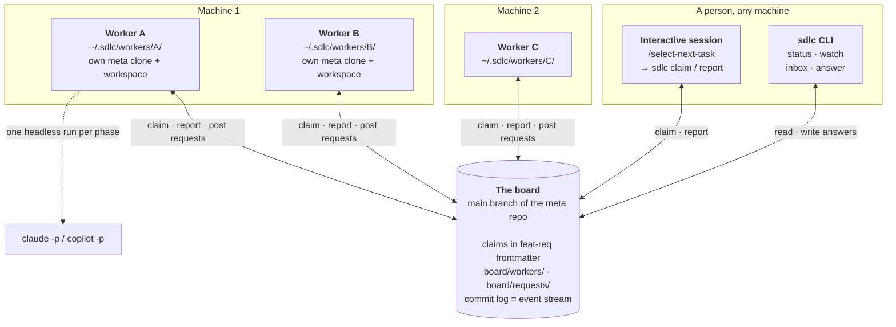

# Workers and the meta-root work board

## Context

Today the kit has one worker: whichever interactive session is open. `select-next-task` says so, `workspace/.current-effort` holds one effort, and ADR 001 names per-effort directories as the upgrade path. Two sessions pick the same item, and a hard stop halts all work until a person answers.

[`docs/feat-req/workers.md`](../feat-req/workers.md) asks for persistent, user-owned **workers** that pull from the shared meta repo's `main` branch, used as a **work board**. Claims are commits that count only once they're validated on main. Leases go stale under one TTL. Every need for a person becomes a **request** file. A `sdlc` CLI is the first client of the board. Its worker lifecycle, claim protocol, request file format and `board/` layout are binding: this design amends them only where marked **Amends spec**, with the reason.

Constraints that bound the solution:
- The solo, single-session experience must not change. No existing test regresses.
- Skills are markdown and vendored. All state lives in the meta repo or the worker's home, never in a skill.
- Scripts stay plain Node (`node:test`, Node 20+). The only dependency is `yaml`. Git and `gh` are the only external tools, plus the agent CLI.
- Workers push straight to `main`. No dispatcher and no service.
- The kit is authored for Claude Code, and the Copilot flavor is generated by `REWRITES`. The worker has to drive both `claude` and `copilot` headless.

The spec's open questions are resolved under [Resolved open questions](#resolved-open-questions).

## Proposed Design

### Overview



Every arrow into the board is the same pull → commit → push → validate step. Workers never talk to each other or to a person directly: everything goes through the board.

Three rules hold the design together:
1. **Only the runtime writes to the board.** An agent run edits files in the worker's meta clone and writes a result file. The runtime (or `sdlc`, in an interactive session) commits, validates the claim and pushes. An agent never pushes the meta repo.
2. **The commit log is the event stream.** Every board commit has a fixed subject and trailers. `watch`, last-seen times and worker state are all read from `git log origin/main`. No other event store exists.
3. **Board mode is opt-in per meta repo.** It turns on when `board/` exists on main. The installer scaffolds it next to `docs/`. The guided flow asks "Will this project run workers, or share one board across several people?" (default no), and `--board` does the same for scripted installs. On yes it creates `board/workers/` and `board/requests/` with `.gitkeep` files, and they reach main with the person's first commit of the meta-root, like the rest of the scaffold. The first `sdlc worker create` creates and pushes them if they're missing, so a project installed solo can add workers later with no extra step. Without `board/`, every skill and script behaves exactly as today. This is how "solo is unchanged" holds.

### Code layout

All new code lives in the kit's `scripts/`, so the installer vendors it to adopters like the other scripts.

```
scripts/
  sdlc.mjs                  CLI entry: argument parsing and dispatch only
  lib/board/
    git.mjs                 the pull / commit / push / validate primitive (all board writes go through it)
    frontmatter.mjs         read and edit YAML frontmatter while keeping the body byte-for-byte
    claims.mjs              claim, renew, release, takeover; stale computation
    queue.mjs               ranking (select-next-task Steps 1 and 3 in code), overlap detection
    requests.mjs            post, answer, withdraw, validate; id generation
    effects.mjs             apply an answered request (the effects table)
    events.mjs              commit subject and trailer format; parse git log into events
    registry.mjs            board/workers/<id>.yml read/write; derived worker state
    redact.mjs              secret redaction
    config.mjs              board settings from board/config.yml, with defaults
  lib/worker/
    home.mjs                worker home layout, config.json, pid file, local state
    loop.mjs                the worker loop
    agent.mjs               headless invocation per agent CLI; result file contract
    preflight.mjs           gh auth, agent CLI present, registry active, config matches registry
```

`render-status.mjs`, `assemble-env.mjs` and `clean-env.mjs` gain small changes (below). The adopter's `package.json` gets `"bin": { "sdlc": "scripts/sdlc.mjs" }`, so both `npx sdlc …` inside a meta repo clone and `npx -p github:<org>/<meta-repo> sdlc worker create` on a fresh machine work.

### The board primitive (`board/git.mjs`)

Every board write goes through one function:

```js
boardWrite(clone, {
  kind,            // 'claim' | 'release' | 'takeover' | 'report' | 'request' | 'answer' | 'apply' | 'register' | 'retire' | 'config' | 'start' | 'stop'
  mutate(tree),    // edits files in the working tree; returns the exact paths it touched (none = empty event commit)
  validate(tree),  // after a fresh pull: true if this write still applies (e.g. claimed_by is still me)
  onReject,        // 'restart' (claims, releases, takeovers, register) | 'rebase' (reports, requests, answers)
  identity,        // { authorName, authorEmail, workerId? }
  subject, trailers,
})
```

Steps: `fetch` + fast-forward to `origin/main` → `mutate` → `git commit --only -- <paths>` (or `--allow-empty` for events) → `push origin HEAD:main`.
- **`restart`**: on a rejected push, `reset --hard origin/main` and return `{ ok: false, reason: 'lost-race' }`. The caller goes back to step 1 of its protocol. This is the claim protocol's step 4.
- **`rebase`**: on a rejected push, `pull --rebase` and retry, up to 5 times with jitter. A rebase conflict means `rebase --abort`, `reset --hard origin/main` and `{ ok: false, reason: 'conflict' }`. It never resolves a conflict in its own favour and never force-pushes. No code path passes `--force`; a test greps for it.
- After the push: fetch again and confirm the commit is an ancestor of `origin/main` (`merge-base --is-ancestor`) and `validate(tree)` holds. This is the claim protocol's step 5. A failure returns `{ ok: false, reason: 'replaced' }`.

In a worker's clone the tree belongs to the runtime. In a person's clone, `sdlc` refuses to run unless the clone is on `main`. It commits only the paths it touched (`--only`) and rebases with `--autostash`, so unrelated local edits are left alone.

### Data on the board

**Claim fields on the feat-req** (flat frontmatter, absent when unclaimed):

| Field | Meaning |
|---|---|
| `claimed_by` | a worker id (`lidorl-7f3a9c`) or a person's login for an interactive session (`lidorl`) |
| `claimed_at` | when this claim started |
| `renewed_at` | the last lease renewal (any report) |
| `awaiting` | the id of the open blocking request; independent of the claim |

A claim is **live** when `claimed_by` is set and `now − (renewed_at ‖ claimed_at) ≤ lease_ttl`. Otherwise it's **stale**. A worker id always has a `-<suffix>`, so it can't collide with a bare login.

**Registry**, `board/workers/<id>.yml`: `id, owner, name, host, agent, model, created_at, retired_at`. Durable identity only, as the spec requires.

**Requests**, `board/requests/<id>.md`, exactly in the spec's format, with two additions (**Amends spec**, because effects must be applied by code and tested, which needs a machine-readable answer):
- an `answer:` frontmatter field. It holds a scalar for most kinds (`approve`, `reject`, `accept`, `park`, `retry`, `confirm`, `correct`, `resolved`, an option letter, `text`) and a map for review gates (`{F1: fix, F2: accept}`). The `## Answer` body keeps the notes and rationales.
- a `## Findings` body section for review gates: one `### F<n>` per finding, so answers can address findings by id.

The validator (`requests.validate`) checks the frontmatter enums, the required body sections per kind, the id shape `^\d{12}-[a-z0-9]{6}$`, the filename matching the id, `answer` being consistent with `kind`, and `status: answered` requiring `answered_by` and `answered_at`. `sdlc check` runs it over `board/`, and tests run it over every file they produce.

**Events** are board commits. Subject: `board(<kind>): <subject>`, for example `board(claim): bulk-export`. Trailers:

```
Worker: lidorl-7f3a9c          # absent for a person's interactive commits
Sdlc-Event: claim              # register | config | start | stop | crash | claim | renew | release | takeover | report | request | answer | apply | withdraw | retire
Effort: bulk-export            # when the event concerns an effort
Request: 202611191253-a1b2c3   # when it concerns a request
Phase: DESIGNED                # on report: the status after the report
Replaces: lidorl-1a2b3c        # on takeover
Answered-by: lidorl            # on answer (for future bot clients; same as author for the CLI)
```

`start` and `stop` are empty commits, so they never conflict. `events.parse()` turns `git log --format=%H%x00%an%x00%aI%x00%s%x00%(trailers:unfold)` into JSON events. `sdlc watch --json` prints that stream, and it's the contract a future control app consumes.

**Derived worker state** (`registry.state(id, events, featReqs, requests)`):
- `retired` if `retired_at` is set;
- `needs-attention` if an open worker-scope error request names it;
- `stopped` if its last `start`/`stop`/`crash` event isn't `start`;
- `working` if it holds a live claim, `stale` if its claim is stale;
- otherwise `idle`.

Last seen is the time of its newest commit. An idle worker pushes nothing, so a hard-crashed idle worker looks idle until its next start. Its next start detects the crash (see Lifecycle). This limitation is accepted and listed in Open Items.

### Worker home and lifecycle

Home: `${SDLC_HOME:-~/.sdlc}/workers/<id>/`

```
config.json        { id, owner, meta_url, agent, model, cli_args, name, author: {name, email} }
meta/              clone of the meta repo; code repos under meta/workspace/ (assemble-env, unchanged)
state.json         local only: clean_stop flag, consecutive failures, backoff_until
worker.pid         present while running
logs/worker.log    runtime log (detached stdout/stderr)
logs/runs/<ts>-<effort>-<phase>.log   one agent run's transcript
meta/.sdlc-run/result.json   the result file for the current agent run (inside the agent's cwd; hidden by meta's .git/info/exclude)
```

Each worker has its own `meta/` clone and holds at most one effort at a time. So `workspace/.current-effort` stays a correct per-worker marker, and ADR 001's single `workspace/` holds unchanged inside each worker. That's the ADR 001 amendment (ADR 005): **per-worker meta clones** replace the deferred per-effort directories.

- **`sdlc worker create --agent claude|copilot --model <m> [--name n] [--meta <url>]`**. `--meta` defaults to the current clone's `origin`.
  1. `gh api user` resolves the login, name and noreply email.
  2. The id is `<login>-<6 lowercase base36 chars>`.
  3. A probe checks the agent CLI and the model with one tiny headless prompt (`--no-probe` skips it).
  4. It creates the home, clones `meta/`, and sets the author and a `commit-msg` hook that adds the `Worker:` trailer.
  5. It checks the meta repo has the kit installed for that agent (`.claude/skills/select-next-task/` for `claude`, `.github/skills/select-next-task/` for `copilot`).
  6. It registers with `boardWrite` (`register`, `onReject: restart`, `validate`: the file is still the one this command wrote).
  If the id is taken, it generates a new suffix and retries (up to 5 times). On any failure, it deletes the home before exiting: no unregistered home is left behind.
- **`start [--detach]`**: preflight, then crash detection. If `worker.pid` exists but its process is dead, or `state.json.clean_stop` is false, it pushes a `crash` event and posts a worker-error request: "crashed; last log lines attached". Then it pushes a `start` event and runs the loop. `--detach` respawns `node meta/scripts/sdlc.mjs worker start <id>` with `detached: true`, stdio to `logs/worker.log`, and `unref()`. It writes the pid file and returns at once.
- **`once`**: like `start`, but it claims, runs one phase, reports, releases and exits. With an empty queue it exits 0 and prints "queue empty".
- **`stop`**: sends SIGTERM and waits up to 60 s. The worker's handler kills the agent child, runs the final report and release, pushes `stop`, sets `clean_stop` and exits. After 60 s it sends SIGKILL, and `stop` itself runs the release and `stop` event from the worker's `meta/` clone.
- **`retire`**: stop if running, release any claim, set `retired_at` (`retire` event), then delete the home. It refuses to delete a home whose `meta/workspace/` checkouts have unpushed commits, unless `--force` (`clean-env.isProtected`).
- **`config <id> --model m`**: updates `config.json` and the registry in one step (`config` event). `start` refuses when `agent` or `model` differ between the two.
- **`status <id>` / `list`**: local homes joined with their derived board state.

**Preflight** runs before every claim: `gh auth status`, the agent CLI on `PATH`, registry entry present and not retired, and config matching the registry. A failure posts a worker-error request (deduplicated: one open per worker) and idles until it's answered `resolved`.

### The worker loop (`worker/loop.mjs`)

```
loop:
  preflight                               → worker error? idle until answered
  if holding an effort E: continue E      (in-flight before new; the workspace is already built)
  else:
    pull; candidates = queue.rank(board) minus live claims minus awaiting-open
    none → sleep idle_poll; continue      (once: exit 0)
    pick top; warn on repo overlap with other live claims (log + claim commit body)
    claim (stale → takeover)              → lost race / replaced → loop
  apply answered requests for E (effects.mjs), in the same commit that deletes them and clears awaiting
  assemble-env E (if DESIGNED+), install trailer hooks in workspace checkouts
  run the agent on E's routed phase, with a timeout; renew the lease every lease_ttl/2 while it runs
  read meta/.sdlc-run/result.json:
    completed  → report (artifacts + new status + renewed lease); continue with E unless IMPLEMENTED
    request    → validate + redact; post; blocking → same commit sets awaiting + releases
    failed / missing / timeout → effort error (blocking) + release + backoff
  push code-repo effort branches before every report and release
  on any "no longer hold E" from validation → drop E, push nothing more for it, log it
```

- **Routing** reuses `select-next-task`'s table. `ACCEPTED` runs `classify-change` then `write-design-doc`. `DESIGNED` runs `write-execution-plan`. `PLANNED` runs Development from the start. `IN_PROGRESS` resumes from the first unchecked plan step. After Development, `close-out` runs. A phase is one agent run.
- **Lease renewal during long runs** (**Amends spec**): the spec renews leases only "on every phase transition and report". A Development run can outlast any sensible TTL, and a takeover in the middle of a live run is exactly the duplicate work the feature exists to prevent. While an agent run is live, the runtime pushes a `renew` event (it touches only `renewed_at`) every `lease_ttl / 2`. An idle worker still pushes nothing. This is not a heartbeat: it happens only while the worker holds a claim, at most twice per TTL. The "no heartbeat" acceptance criterion is read as "an idle or working worker pushes nothing beyond claims, renewals and reports".
- **Code-repo branches** are pushed (`git push -u origin feat/<slug>`, never forced) before every report and release, so a takeover's `assemble-env` finds `origin/feat/<slug>` (its existing case 2) and resumes from it. A rejected code push is an effort error.
- **Takeover** uses `boardWrite`: it sets the new `claimed_by`, `claimed_at` and `renewed_at`, adds a `Replaces:` trailer, and appends a line to the feat-req's `## Decisions` section.
- **Backoff**: after an effort error the worker sleeps `backoff[min(n, len-1)]` (default 5 m, 15 m, 60 m), with `n` the consecutive failures. The count resets on a completed phase. The failed effort itself is blocked by its error request, so the worker never retries it unattended.

### Headless agent invocation (`worker/agent.mjs`)

One run per phase, in `meta/` as the working directory, with a timeout (`phase_timeout`, default 3 h). The prompt is built from a template:

> You are SDLC worker `<id>`, running headless. Phase: `<phase>` for effort `<slug>`. Run the `<skill>` skill [for Copilot: follow `.github/skills/<skill>/SKILL.md`]. Follow "Headless mode" in the process contract: you cannot ask anyone anything. Do not commit or push in the meta repo. Commit in code repos on `feat/<slug>` only. Answered requests to apply first: <inline answer bodies>. When you stop, write `$SDLC_RESULT_FILE`.

| CLI | Command |
|---|---|
| `claude` | `claude -p <prompt> --model <m> --output-format json --settings <home>/agent-settings.json ...cli_args` |
| `copilot` | `copilot -p <prompt> --model <m> --allow-all-tools --no-color ...cli_args` (path verification stays on: no `--allow-all-paths`, no `--add-dir`) |

`agent-settings.json` is written at `create`. It turns on Claude Code's sandbox, so writes stay inside `meta/` with network allowed for git, and auto-allows sandboxed Bash, so the run works unattended inside the worker's home and nowhere else. `SDLC_RESULT_FILE`, `SDLC_WORKER_ID` and `SDLC_HEADLESS=1` are set in the child's environment.

**Result file** (the agent's only channel back; **answers "Headless invocation"**):

```json
{ "outcome": "completed" | "request" | "failed",
  "phase": "DESIGNED",                       // completed: the status the effort is now in
  "summary": "one line for the report commit",
  "request": { "kind": "gate|question|clarification|error", "gate": "...", "for": "<login>|approvers|owner",
               "blocking": true, "sections": { "Request": "...", "Context": "...", "Options": "...", ... } },
  "error": { "message": "...", "tried": "..." } }
```

A missing or invalid file, a non-zero exit or a timeout becomes an effort error. The runtime builds it with the message, the last 50 log lines (redacted) and "tried: <the result summary if any>". There's one exception: stderr matching a model-not-found pattern, or a missing CLI, becomes a **worker** error instead. `for: owner` resolves to the effort's feat-req author (`git log --diff-filter=A --format=%an`), falling back to the worker's owner.

**Headless mode in the process contract** (a new subsection under Autonomy Policy, read by skills through the contract they already load). When `SDLC_HEADLESS=1`:
- every always-hard-stop gate, and every gate the policy sets to `confirm`, `discuss` or `pause`, becomes a `request` result with `kind: gate`;
- a need for information becomes a `question`;
- a judgment call with a safe default becomes a `clarification`, with the assumption recorded in the effort's docs;
- `task_selection` does not apply (**Amends spec**): the runtime selects the task. A `confirm` gate on every pick would make workers useless, and starting a worker is the operator's consent to it picking. Every other policy gate applies as the spec says.
- `technical_brainstorm: discuss` becomes a policy gate that carries the 2–3 approaches as `## Options`, before the design doc is written.

### Answers and effects (`board/effects.mjs`)

Effects are applied by code wherever the effects table names a mechanical change, so each one is testable. The agent receives the answer text in its prompt for the parts that need judgment.

| Kind / answer | Code applies | The agent gets |
|---|---|---|
| design `approve` | design doc `status: APPROVED`, feat-req `DESIGNED` | — |
| design `reject` | design doc stays `DRAFT`, feat-req stays `ACCEPTED`; routes to `write-design-doc` | notes as design input |
| triage `accept`/`park`/`reject` | feat-req `status`; `## Triage` with the reason for park/reject | — |
| review, per finding | `fix` → append `- [ ] Fix review finding F<n>: <title> (request <id>)` under `### Review fixes (<id>)` in the plan; `accept` → rationale in `## Decisions` | — |
| policy `approve`/`reject` | reject → feat-req back to the previous phase status | approve → "proceed with the gated step"; reject → notes |
| question | — | the option or text |
| clarification `confirm`/`correct` | correct, with a plan that isn't `IMPLEMENTED` → append a rework step; correct after `IMPLEMENTED` → write a follow-up feat-req (`status: ACCEPTED`, `source: Clarification <id> on <slug>`) and post a triage gate for it | correct with no plan yet → the correction as input |
| effort error `retry`/`park`/`text` | park → feat-req `PARKED`, `## Triage` reason = the error | retry → resume; text → instructions |
| worker error `resolved` | worker leaves needs-attention | — |

**Where decisions are recorded** (**Amends spec**): the spec says "the history entry's Decisions, or the design doc". The runtime instead appends to a `## Decisions` section in the **feat-req**: `- 2026-11-20 · <request id> · <kind>: <answer> — <notes> (applied by <worker>)`. The feat-req exists in every phase. A history entry doesn't exist before Development, and design-doc headings are a fixed contract parsed by other skills. `## Triage` is the precedent for an appended feat-req section.

The apply step, the request file deletion and clearing `awaiting` happen in one `apply` commit, made after the claim validates. A clarification answered while the worker holds the effort is picked up at the worker's next report check (`requests.answeredFor(effort)`) and applied before the next agent run. `sdlc answer` writes only the request file: it validates `status: open` after its pull and again after a rebase, and rejects a second answer.

### Interactive sessions

Board mode only. Without `board/`, nothing changes.
- `select-next-task` Step 1 calls `node scripts/sdlc.mjs next --json`. It uses the same `queue.rank`, so there's one ranking implementation. It skips live claims and `awaiting`-open efforts, prints overlap warnings, and the skill keeps the user-override rule. After the person confirms, it runs `sdlc claim <slug>`, which claims as the person's login.
- Every phase skill that changes `status` ends with `sdlc report <slug> --phase <status>`. It re-validates the claim, commits the effort's docs and pushes. If the claim was taken over, it prints "<slug> is now held by <worker>; nothing was pushed", and the skill tells the person and stops. This satisfies the "same TTL, warn" decision.
- `close-out` ends with `sdlc release <slug>`.
- Interactive sessions do not register in the worker table. They appear as claimants by login (**answers "Interactive vs headless identity"**).

### `sdlc` command summary

| Command | Writes to the board |
|---|---|
| `sdlc worker create / start [--detach] / once / stop / status / list / retire / config` | register, start, stop, crash, retire, config |
| `sdlc next [--json]` | — |
| `sdlc claim <slug>` / `report <slug> --phase <s>` / `release <slug>` | claim, report, release (interactive) |
| `sdlc status` | — (renders the board view to the terminal) |
| `sdlc watch [--interval 30] [--json] [--since <sha>]` | — |
| `sdlc inbox [--all]` | — (yours plus `approvers`, oldest first) |
| `sdlc answer <id> [--choice X] [--note "..."]` | answer (request file only) |
| `sdlc check` | — (validates every `board/` file) |

### Settings: `board/config.yml`

**Answers "Defaults"**:

```yaml
# board/config.yml — board and worker settings, shared by everyone on this board
lease_ttl: 4h            # a claim with no report or renewal for this long is stale, and anyone may take it over
idle_poll: 60s           # how often an idle worker pulls the board
phase_timeout: 3h        # the longest one agent run may take
backoff: [5m, 15m, 60m]  # waits after consecutive effort errors
watch_interval: 30s      # default poll interval for `sdlc watch`
```

Why a YAML file under `board/` and not a block in `CLAUDE.process.md`:
- `CLAUDE.process.md` is kit-owned. The installer overwrites it on every re-run, so tuned settings there would be lost on upgrade.
- Its path differs per flavor (`.github/instructions/sdlc-process.instructions.md` for Copilot). `board/config.yml` is the same for both.
- Only code reads these settings (`config.mjs`, with the `yaml` dependency the kit already has). No agent needs them in context.
- They only matter in board mode, so they live with the board. Settings are shared, because every worker and session must agree on `lease_ttl`.

The installer seeds the file with these defaults when it scaffolds `board/`, and keeps an existing one on re-run, as it does for `CLAUDE.stack.md`. `sdlc worker create` writes it if it's missing. Missing keys fall back to the defaults, and `sdlc check` validates the file. Changing it is an ordinary commit to main. Workers pick up the change on their next pull.

### Changes to existing files

- **`render-status.mjs`**: if `board/` exists, it adds a **Workers** table grouped by owner (id, name, host, agent/model, state, current effort, last seen), an **Inbox** grouped by `for` (oldest first), and **Claimant / Claim age / Stale** columns on in-flight rows. It reads `git log` through `events.parse`. Without git it renders the board section from files alone, with last seen as `-`. `docs/.status.json` gains `workers` and `requests`.
- **`assemble-env.mjs`**: a new `hooks: { workerId }` option installs the `commit-msg` trailer hook in each non-readonly checkout. Its default behaviour is unchanged.
- **`clean-env.mjs`**: exports `isProtected` for `retire`. No behaviour change.
- **Skills**: `select-next-task` (claims, skip rules, drop the single-worker note), `write-design-doc`, `write-execution-plan` and `close-out` (a board report or release when board mode is on), and every skill with a gate (one line: "Headless: see the process contract's Headless mode"). Edited with `writing-for-agents`.
- **`CLAUDE.process.md`**: State (claim fields, `awaiting`, `## Decisions`), Autonomy Policy (Headless mode), and a new **Workers and the board** section.
- **Installer**: vendors `scripts/sdlc.mjs` and `scripts/lib/{board,worker}/`, and adds `bin.sdlc` to `package.json`. It asks the "run workers?" question in the guided flow, after the location is chosen and before "Here's what will happen", and shows `board/` in the preview tree when the answer is yes. It accepts `--board`, and on yes scaffolds `board/{workers,requests}/.gitkeep` and seeds `board/config.yml`. A re-run never removes an existing `board/` or overwrites `board/config.yml`, and a re-run with `--board` adds it. Copilot `REWRITES` may need rules for new wording; `npm test` enforces that.
- **README**, **`docs/design/architecture.md`** (the board, worker homes, the "only the runtime writes the board" invariant), and **ADR 005**.

### Resolved open questions

| Spec question | Decision |
|---|---|
| How `sdlc` ships | In-kit `scripts/sdlc.mjs`, exposed as `bin` in the meta repo's `package.json`. `npx -p github:<org>/<meta> sdlc worker create` covers a fresh machine. The board format, not the library, is the contract a control app depends on. A standalone npm package stays an option later. |
| Worker home location | `~/.sdlc/workers/<id>/`, overridable with `SDLC_HOME`. |
| Moving a worker | Not in v1. Retire and create. Open item. |
| Silent crashes | Next start detects it (stale pid or no clean stop), pushes `crash` and posts a worker error. Idle crashes stay invisible until then (see Open Items). |
| Notifications | v1 is `inbox` / `watch` only. The Slack bridge is `BRAINSTORMING.md` §13. |
| Approval latency | No nudge. An idle worker picks it up within `idle_poll`. |
| Redaction | A pattern list (below). If redaction throws, the excerpt is dropped and replaced by "excerpt withheld: redaction failed". The request still posts. |
| Polling | `watch_interval` 30 s, `--interval` overrides it. The event format is the commit trailer schema above, available as `--json`. |
| Answering from a session | No `/answer` skill in v1. `sdlc answer` or a file edit. Open item. |
| Model validation | `create` probes the CLI and the model by default (`--no-probe` skips). At runtime, a model error becomes a worker error. |
| Claim commit format | `board(<kind>): <subject>` plus trailers. |
| Headless invocation | One `claude -p` / `copilot -p` run per phase, with a result file (above). |
| Defaults | `board/config.yml` above. |
| Interactive identity | Claimants by login, not in the worker table. |
| Approvers | `for: approvers` shows in everyone's `inbox` and as its own STATUS.md group. Anyone may answer (access control is out of scope). |
| Empty queue | Idle and poll; `once` exits 0. Workers don't run `gather-open-items` sweeps in v1 (open item). |
| Overlap | Direct intersection of non-readonly repos in `repos:`. `depends_on` is ignored, and readonly repos never count. |

## Data Model & Schema Changes

No database. The persistent formats this adds:
- **Feat-req frontmatter**: `claimed_by`, `claimed_at`, `renewed_at`, `awaiting` (all optional). A new appended body section `## Decisions`.
- **`board/workers/<id>.yml`**: `id, owner, name, host, agent, model, created_at, retired_at`.
- **`board/requests/<id>.md`**: the spec's format plus `answer:` and, for review gates, `## Findings`.
- **Board commit trailers**: `Worker`, `Sdlc-Event`, `Effort`, `Request`, `Phase`, `Replaces`, `Answered-by`.
- **`board/config.yml`**: `lease_ttl`, `idle_poll`, `phase_timeout`, `backoff`, `watch_interval`.
- **Worker home** (local, not shared): `config.json`, `state.json`, `agent-settings.json`, `meta/.sdlc-run/result.json`.

The kit keeps its data contracts in `CLAUDE.process.md` (State) and `architecture.md`, and has no `data-model.md`. These are documented there instead of creating one.

## API Surface Changes

No HTTP API. The contracts are:
- the **`sdlc` CLI** (command summary above), with `--json` output for `next`, `status`, `watch`, `inbox` and `check`;
- the **board file formats and the event trailer schema**, the stable interface for future clients (control app, Slack bridge);
- the **agent result file** (`$SDLC_RESULT_FILE`) and the `SDLC_HEADLESS` / `SDLC_WORKER_ID` environment;
- **`assemble-env.assemble({ hooks })`** and **`clean-env.isProtected`** (new exports).

Auth: git and `gh` credentials on the machine. There's no access control beyond push rights to the meta repo (out of scope).

## Repositories in Scope

N/A. Single-repo effort: `sdlskills` owns every change (scripts, skills, process contract, installer, docs). Workspace assembly is skipped as a formality for N=1.

## UI/UX Changes

No graphical UI. User-facing CLI output follows the installer's existing terminal conventions (`scripts/lib/style.mjs` colors, `ui.mjs` menus for `sdlc answer` choices), and colors turn off when the output isn't a TTY. New output:
- STATUS.md: the Workers table, the Inbox, and the claim columns.
- `sdlc status`, `inbox`, `watch` and `answer` terminal views.
- The interactive-session warning when a claim is lost.

There's no `STYLE_GUIDE.md` in this repo.

## Alternatives Considered

- **A separate `board` branch instead of `main`.** It keeps `main` free of event commits and works with branch protection. Rejected because the spec requires main, and splitting state across two branches breaks "pull once, see everything": artifacts live on main, so claims would race them across branches. → ADR 005.
- **GitHub Issues or the API as the board.** It brings notifications and access control for free. Rejected: it ties the core protocol to GitHub's API and rate limits, and it moves state out of the repo the skills read. It stays possible as a mirror, the same way as the Slack bridge.
- **Per-effort directories in one shared meta clone** (ADR 001's named path). Rejected: several workers in one clone would share a git index and race each other's commits. Per-worker clones need no change to `assemble-env`. → ADR 005.
- **Heartbeat commits for liveness.** They give exact stale detection but flood history, which the spec forbids. Leases are renewed only while working. Idle liveness is not tracked.
- **The agent pushes its own board commits.** It's simpler to invoke, but then claim validation depends on the model following instructions. Rejected: only the runtime writes the board.
- **Exit codes for the agent outcome.** Too narrow to carry a request, and both CLIs exit 0 when the model stops. Rejected for a result file.
- **Agent-applied effects.** It's uniform, but untestable against the acceptance criterion "each effect covered by a test". Mechanical effects are applied by code instead.
- **Board always on.** Rejected: it would push to main from every solo session, so solo would no longer be unchanged. Opt-in via `board/`.
- **A separate npm package for `sdlc`.** It's cleaner for a future app, but it adds a second distribution channel. Deferred, because the board format already decouples the clients.
- **Recording decisions in history entries.** Rejected: history entries don't exist before Development. The feat-req's `## Decisions` instead.

## Testing Strategy

All `node:test`, under `scripts/lib/board/*.test.mjs` and `scripts/lib/worker/*.test.mjs`. A shared fixture builds a **bare remote plus N clones** in a temp dir, and a **fake agent** (`scripts/lib/worker/fixtures/fake-agent.mjs`, selected through the config's `agent_cmd` override) writes a scripted `result.json` and edits files.

| Test | Acceptance criteria covered |
|---|---|
| `create`: id shape, registry file, author, rollback on push failure, id collision retry (with a stubbed `gh`) | create, unregistered-home |
| Two clones claim the same effort with a `beforePush` hook interleaving them; exactly one wins and the other claims the next item | two workers never claim the same effort |
| Rejected push; rebase conflict on claim fields; claim replaced between push and validate | claim on origin/main + validate; never force (plus a grep test for `--force`) |
| Awaiting-open efforts are skipped by `queue.rank` | no claim while awaiting |
| A takeover with stale `renewed_at`; the old worker's next report pushes nothing; the interactive `report` prints the takeover warning | stale/takeover, taken-over worker stops, interactive re-validation |
| Lease renewal fires at TTL/2 during a long fake run; an idle loop pushes nothing over a simulated hour | no heartbeat |
| Every commit in a loop run carries the `Worker:` trailer and owner author, including a code-repo commit through the hook | traceability |
| Each request kind is posted; blocking ones set `awaiting` and release in one commit; `requests.validate` passes on all of them | request kinds, file format |
| `redact.mjs` on planted `ghp_`, `github_pat_`, `sk-ant-`, `sk-`, `AKIA`, `xoxb-`, JWT, PEM, `Authorization: Bearer`, URL credentials, `password=` | redaction |
| One test per effects-table row (11 cases), each asserting the resulting files, a `## Decisions` line citing the id, and the request file gone | each effect, decision recorded |
| A clarification corrected mid-hold adds a rework step before the next run; after `IMPLEMENTED` it files a follow-up plus a triage gate | clarification rework |
| `sdlc answer` touches only the request file; a second answer is rejected | clients don't change lifecycle |
| Fake agent exits 1 / times out / writes no result → effort error with a redacted excerpt, released, backoff applied | agent failure |
| Missing CLI / failed `gh auth` / model error → worker error, needs-attention, no claims until answered `resolved` | worker error |
| SIGTERM → release + `stop` event; stale pid → `crash` + worker error | signal stop, silent crash |
| `start --detach` returns at once and survives the parent; `stop` ends it | detach |
| `watch --json` sees each event kind within one interval | watch |
| `render-status` with a fixture board: Workers, Inbox, claim columns; without `board/`: output byte-identical to today | STATUS.md, solo unchanged |
| `queue.rank` matches `select-next-task`'s rules on fixture feat-reqs; overlap warning names both efforts and the repos | ranking, overlap |
| Installer: `--board` and a guided "yes" scaffold `board/{workers,requests}/` and seed `board/config.yml`; "no" and the default don't; a re-run keeps an existing `board/` and a hand-edited `config.yml`; Copilot layout too | solo unchanged, board opt-in |
| Registry config mismatch refuses to start; `config --model` updates both | model config |

Agent CLI behaviour itself (the `claude -p` sandbox, Copilot path checks) gets a manual smoke run recorded in the history entry, not CI tests.

## Rollout & Migration

- **Opt-in.** Existing meta repos are untouched until the installer is re-run with `--board` or someone runs `sdlc worker create`. Feat-reqs without claim fields read as unclaimed.
- **Suggested plan split** (the plan phase decides):
  1. The board library: `git`, `frontmatter`, `claims`, `queue`, `requests`, `effects`, `events`, `registry`, `redact`, `config`, plus `sdlc check / next / claim / report / release / answer / inbox / status / watch`.
  2. The worker runtime: `home`, `preflight`, `agent`, `loop`, plus `sdlc worker *`.
  3. Integration: skills, `CLAUDE.process.md`, `render-status`, `assemble-env` hooks, installer, README, architecture.md, ADR 005, site.
- **Adopter prerequisites**, documented in the README: push rights to main for every worker owner, with force-push forbidden; `gh auth setup-git`; the agent CLI installed and logged in.
- **Upgrade.** Re-running the installer vendors the new scripts and adds `bin.sdlc` only if absent (it never overwrites the adopter's `package.json` edits).

## Security Considerations

The Security Review triggers that apply are **auth** (it uses the machine's git and `gh` credentials) and **unattended code execution** (a headless agent with tool permissions). `/security-review` is required at close-out.
- **Containment.** Claude runs sandboxed through `agent-settings.json` (writes stay in `meta/`). Copilot keeps path verification but its shell commands aren't sandboxed. The README recommends a dedicated OS user or VM for Copilot workers. Listed in Open Items.
- **Secrets on a shared repo.** Every error excerpt and log line in a request goes through `redact.mjs` before it's written. Failure drops the excerpt. Patterns include env values whose names match `TOKEN|SECRET|KEY|PASSWORD`, and the redaction runs on the in-memory text before any file write.
- **Prompt injection.** Request answers and feat-req text reach the agent's prompt, and anyone with push rights can write them. That's the same trust boundary as today's docs. The runtime never executes answer text, and only `effects.mjs` code changes lifecycle state.
- **History integrity.** No force-push anywhere (a test asserts it), and adopters should forbid force-push on main.
- **No access control on gates.** Anyone with push rights can approve. That's out of scope and noted for the Slack bridge.

## Open Items

- [ ] **Idle crash visibility**: a worker that crashes while idle looks idle on the board until its next start. Revisit if it bites; it would need an idle liveness signal without heartbeat commits.
- [ ] **Copilot worker containment**: its shell commands aren't sandboxed. For now we only document it; revisit when the Copilot CLI offers a sandbox.
- [ ] **Moving a worker between machines** under the same id. Not supported; retire and create.
- [ ] **`/answer` skill** for answering from inside a session.
- [ ] **Empty-queue sweeps by workers** (`gather-open-items` claimed as a singleton).
- [ ] **Interim notifications** before the Slack bridge (`BRAINSTORMING.md` §13).
- [ ] **Approver routing** (who is an approver) and access control on gates.
- [ ] **Two interactive sessions of one person** share a claimant id (the login) and can both act on one effort. Accepted for v1.
- [ ] **Event scan cost**: `render-status` and `watch` read `git log` of main. Bound it to the last N commits or a time window if large boards get slow.
- [ ] **Standalone `sdlc` npm package** for a control app (`BRAINSTORMING.md` §12).
- [ ] **Claims arbitrated by a GitHub workflow** (claim PRs merged one at a time by a `concurrency: 1` workflow) would remove the client-side race and allow a protected main (`BRAINSTORMING.md` §14).
- [ ] **Project-wide "stop all work" switch**: a board flag every worker honors, to stop all workers at once (`BRAINSTORMING.md` §15).
